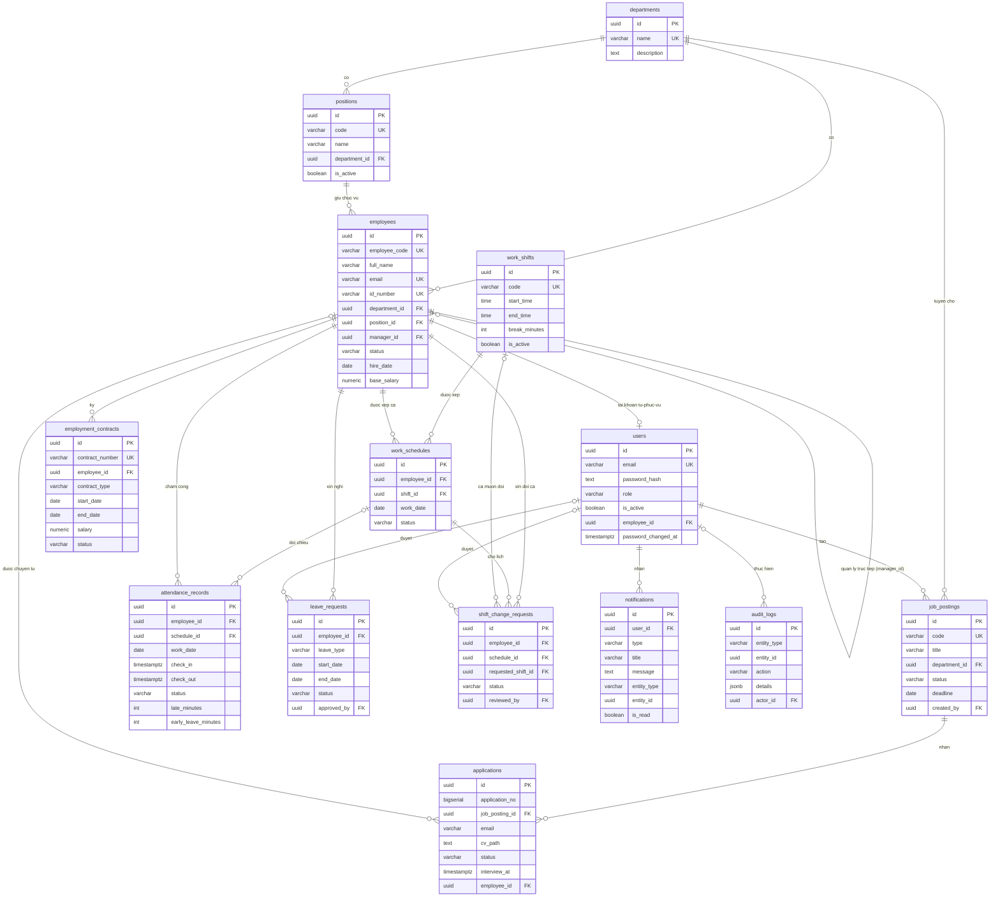

# Kien Truc He Thong (ban cuoi)

Phien ban 1.0 (31/10/2026). Yeu cau chuc nang: [SRS.md](SRS.md). API: [API.md](API.md), Swagger
`/api/docs` ([openapi.json](openapi.json)). Trien khai: [DEPLOYMENT.md](DEPLOYMENT.md).

## 1. Tong quan

```text
Trinh duyet ── React SPA (Vite) ──HTTP/JSON──> Express REST API ──SQL──> PostgreSQL 16
                 │                                   │
                 │                                   ├─ JWT (access + refresh), phan quyen theo vai tro
                 │                                   ├─ Validation (zod), Helmet, CORS, rate limit
                 │                                   ├─ Upload: avatar (public), CV ung vien (khong public)
                 │                                   ├─ Xuat file: Excel (exceljs), PDF (pdfkit + font DejaVu)
                 │                                   ├─ Thong bao trong ung dung, audit log
                 │                                   └─ Tac vu nen: tu ghi Vang (AUTO_MARK_ABSENT)
                 ├─ Trang tuyen dung cong khai (khong dang nhap)
                 └─ Trang quan tri / tu-phuc-vu (dang nhap)
```

Kien truc 3 lop: giao dien (React) chi goi API; backend xu ly nghiep vu, phan quyen va truy van
SQL truc tiep qua `pg` (khong ORM); PostgreSQL luu toan bo du lieu, rang buoc toan ven bang khoa
ngoai, unique index va CHECK.

## 2. So do trien khai (Docker Compose)

```text
                    ┌───────────────────────────────┐
  Nguoi dung ─────> │ frontend (nginx:1.27-alpine)  │  cong FRONTEND_PORT (8080; staging 8081)
                    │ - phuc vu ban build React     │
                    │ - proxy /api, /uploads        │
                    └──────────────┬────────────────┘
                                   │ http://backend:4000
                    ┌──────────────▼────────────────┐
                    │ backend (node:22-alpine)      │  cong BACKEND_PORT (4000; staging 4001)
                    │ Express API, log JSON         │  healthcheck GET /api/health (kiem tra CSDL)
                    │ volume: uploads, storage (CV) │
                    └──────────────┬────────────────┘
                                   │ postgres://db:5432
                    ┌──────────────▼────────────────┐
                    │ db (postgres:16-alpine)       │  volume postgres_data
                    └───────────────────────────────┘
```

- Ca 3 service co healthcheck, `restart: unless-stopped`, log `json-file` xoay vong (5 × 10 MB).
- Staging va production dung chung `docker-compose.yml`, tach bang env file + ten project
  (`--env-file .env.staging -p web-hr-staging`), chay song song duoc tren cung may chu.

## 3. CI/CD

```text
push / pull request ──> build (lint, unit test, build FE, kiem tra openapi.json)
                    ──> docker-build (build image backend + frontend)
                    ──> api-tests (PostgreSQL that: db:setup → smoke test → Postman/Newman)
push nhanh Dev     ──> deploy-staging (SSH → scripts/deploy.sh: sao luu CSDL → build → db:setup
                                       → health check → tu rollback neu loi)
```

File: `.github/workflows/ci.yml`. Job `deploy-staging` can secret `STAGING_HOST`, `STAGING_USER`,
`STAGING_SSH_KEY`, `STAGING_PATH`; chua cau hinh thi tu bo qua.

## 4. Frontend

- Thu muc `frontend/src`. ReactJS + Vite, dieu huong bang hash (`#employees`, `#my-schedule`...).
- `App.jsx`: khung trang (menu theo vai tro, thanh tieu de, chuong thong bao), dieu huong.
- `components/`: moi man hinh mot component (`*Panel.jsx`), hop thoai dung chung (`FormDialog`, `ConfirmDialog`),
  bieu do (`charts.jsx`), `NotificationBell.jsx`.
- File dung chung: `api.js` (goi API, refresh token), `format.js` (nhan tieng Viet, dinh dang ngay/gio/so),
  `messages.js` (dich loi backend sang tieng Viet), `roles.js` (phan quyen phia giao dien).

## 5. Backend

- Thu muc `backend/src`. Node.js 22 + Express 5, ES modules.
- `server.js`: middleware (Helmet, CORS, JSON, request logger), gan route, xu ly loi tap trung,
  health check, tac vu nen, dung em khi nhan SIGTERM.
- `routes/*.routes.js`: moi nhom API mot file; `middleware/` (`requireAuth`, `requireRole`, rate limit);
  `utils/` (audit log, thong bao, tinh gio cong/OT, tinh cong theo ca, xuat PDF, logger, mui gio);
  `openapi/` (tai lieu OpenAPI viet tay, moi nhom mot file).

| Nhom | Duong dan (tien to `/api`) | Dang nhap |
| --- | --- | --- |
| Xac thuc | `/auth/login`, `/auth/refresh`, `/auth/me`, `/auth/change-password` | Khong / Co |
| Tai khoan | `/users` | Admin |
| Phong ban, chuc vu | `/departments`, `/positions` | Co |
| Nhan vien | `/employees` (gom `/me`, `/lookup`, `/import`, `/export`, `/:id/history`) | Co |
| Hop dong | `/contracts` | Co |
| Tuyen dung cong khai | `/public/jobs` | Khong |
| Tin tuyen dung, ho so | `/jobs`, `/applications` | Co |
| Ca lam viec, lich phan ca, doi ca | `/work-shifts`, `/work-schedules` | Co |
| Cham cong | `/attendance-records` (gom `/check-in`, `/check-out`, `/me`, `/monthly-summary`, `/mark-absent`) | Co |
| Nghi phep | `/leave-requests` | Co |
| Thong bao | `/notifications` (`/me`, `/:id/read`, `/me/read-all`) | Co |
| Bao cao | `/reports` (`dashboard`, `by-department`, `work-hours`, `export?format=xlsx|pdf`) | Co |
| He thong | `/health`, `/docs` | Khong |

## 6. Co so du lieu

`database/schema.sql` (idempotent: `CREATE TABLE IF NOT EXISTS`, `ADD COLUMN IF NOT EXISTS`),
`seed.sql` (du lieu goc), `sample-data.sql` (du lieu demo). Chay `npm run db:setup`
(`LOAD_SAMPLE_DATA=true` de nap them du lieu demo).

### 6.1 ERD



### 6.2 Danh muc bang

| Bang | Noi dung | Rang buoc chinh |
| --- | --- | --- |
| `departments` | Phong ban | Ten duy nhat; khong xoa khi con nhan vien |
| `positions` | Danh muc chuc vu | Ma duy nhat |
| `employees` | Ho so nhan vien | Ma, email, CCCD duy nhat; `manager_id` tu tham chieu |
| `users` | Tai khoan dang nhap, vai tro | Email duy nhat; moi ho so toi da 1 tai khoan |
| `employment_contracts` | Hop dong lao dong | Moi nhan vien toi da 1 hop dong dang hieu luc |
| `job_postings` | Tin tuyen dung (`DRAFT`, `OPEN`, `CLOSED`) | Ma duy nhat |
| `applications` | Ho so ung vien | Moi email 1 ho so dang xu ly / tin |
| `work_shifts` | Danh muc ca | Ma duy nhat; gio nghi >= 0 |
| `work_schedules` | Lich phan ca theo ngay | 1 ca / nhan vien / ngay |
| `attendance_records` | Cham cong theo ngay (`PRESENT`, `LATE`, `ABSENT`, `ON_LEAVE`), phut tre / ve som | 1 ban ghi / nhan vien / ngay |
| `leave_requests` | Don nghi phep | `end_date >= start_date` |
| `shift_change_requests` | Yeu cau doi ca | Trang thai `PENDING`/`APPROVED`/`REJECTED` |
| `notifications` | Thong bao trong ung dung | Xoa tai khoan thi xoa thong bao |
| `audit_logs` | Nhat ky thao tac | Chi muc theo `entity_type` + `entity_id` |

## 7. Cac luong nghiep vu chinh

- **Duyet doi ca**: nhan vien `POST /work-schedules/:id/change-requests` → HR `PATCH /change-requests/:id`
  (kiem tra gioi han gio/tuan, cap nhat lich) → ghi audit log → tao `notifications` cho tai khoan cua nhan vien.
- **Tinh cong theo ca**: check-in ghi trang thai `LATE` + `late_minutes`; check-out ghi `early_leave_minutes`;
  tac vu nen (hoac `POST /attendance-records/mark-absent`) ghi `ABSENT` cho ca da xep khong cham cong;
  `utils/workHourStats.js` tong hop gio cong/OT dung chung cho bang cong, bao cao, Excel/PDF va Tong quan.
- **Nghi phep**: don → duyet → ghi `ON_LEAVE` cho ngay lam viec (chuyen `ABSENT` chua cham cong thanh
  `ON_LEAVE`) → thong bao.

## 8. Kiem thu

- `npm test`: unit test backend (Vitest + Supertest, mock tang DB), gom kiem tra spec OpenAPI khop route.
- `npm run test:smoke`: smoke test API tren CSDL that (`backend/scripts/smokeTest.js`).
- `tests/postman`: bo Postman (dang nhap, CRUD, phan quyen), chay bang Newman tren CI.
- Ke hoach kiem thu: [TEST_PLAN.md](TEST_PLAN.md). Bao mat: [SECURITY_CHECKLIST.md](SECURITY_CHECKLIST.md).
